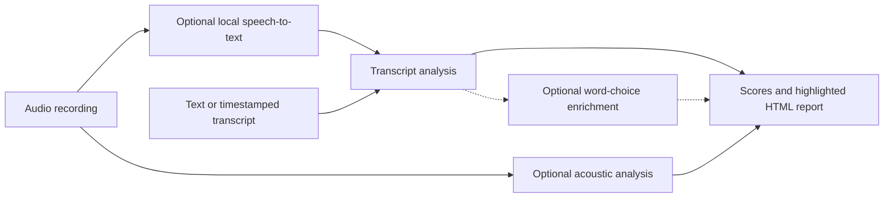

# orator: speech grading

Orator is a Python CLI that grades spoken transcripts and audio on delivery (fillers, pace, pauses, monotone, energy) and content (vocabulary richness, readability, hedging words, repetitions). It also flags hesitation stumbles where a speaker pauses or uses a filler and reaches for a weak word, suggesting a stronger replacement.

Core transcript analysis runs offline on CPU with no model download. Optional extras add verbatim speech-to-text, acoustic prosody analysis, and LLM word-choice enrichment. Scores are deterministic heuristics for practice and review, not clinical assessments.

## From recording to feedback



Text-only grading runs offline. Timestamps unlock pace and pause measures; audio adds optional prosody analysis.

## Why verbatim ASR matters

Standard speech-to-text engines delete filler words by default. If a recognizer strips "um" and "uh" during transcription, downstream code cannot count them. Orator configures its ASR backend with a verbatim decode prompt and word-level timestamps so the analysis layer stays engine-agnostic.

## Installation and Quickstart

Requires Python 3.10 or newer.

```bash
# Create a virtual environment
python -m venv .venv

# Unix / macOS: .venv/bin/python -m pip install -e .
# Windows:      .venv\Scripts\python -m pip install -e .
pip install -e .
```

### 1. Grade a transcript offline (no model weights, no network)

```bash
# Grade a canonical word-timestamp JSON fixture (synthetic fixture included)
orator tests/fixtures/sample_transcript.json --offline --html report.html

# Grade a plain-text transcript (.txt, .md, .vtt, .srt)
orator answer.txt --html report.html
```

Plain-text transcripts skip timing-only dimensions (pace, pauses) automatically and redistribute their weight across the remaining dimensions.

### 2. Grade an audio file (requires `asr` and `acoustic` extras)

```bash
pip install -e ".[asr,acoustic]"
orator talk.wav --backend faster-whisper --acoustic --html report.html
```

### 3. Optional word-choice enrichment (`llm` extra or agent handoff)

Core scoring runs locally without an API key. For deeper word-choice suggestions, use either the Anthropic API (`--llm`, which sends transcript text to Anthropic) or a two-step local JSON handoff:

```bash
# Option A: Anthropic API (requires ANTHROPIC_API_KEY)
pip install -e ".[llm]"
orator talk.wav --llm --effort high --html report.html

# Option B: Key-free JSON handoff
orator answer.txt --emit-request --html report.html
# Fill answer.txt.llm-response.json ({"findings": [...]}), then merge:
orator answer.txt --wordchoice-json answer.txt.llm-response.json --html report.html
```

Open `report.html` to view the overall score, dimension breakdown, and inline-highlighted transcript. A static sample output is checked in at [sample report](examples/sample_report.html).

## What it measures

| Dimension | What it catches | Inputs required |
|---|---|---|
| Fillers | um, uh, like, you know, basically (pause-gated, context-aware) | text + timestamps |
| Pace | words per minute against a target band, plus consistency over time | text + timestamps |
| Pauses and fluency | mid-clause pauses, repetitions, false starts | text + timestamps |
| Word choice / tripped-up | hesitation co-occurring with a weak word, plus replacement candidates | text + timestamps (+ optional LLM) |
| Vocabulary | length-robust lexical diversity (MATTR / MTLD) | text |
| Hedging | maybe, I think, kind of, very, really (density) | text |
| Readability | spoken grade level | text |
| Prosody (optional) | pitch range, energy dynamics, acoustic filled pauses | audio + `acoustic` extra |

### How "tripped-up" detection works

A weak word alone is not flagged as a stumble. Orator fuses signals on a shared time axis:

```text
event_score = w*hedge + w*vague + w*pause_before + w*(low ASR confidence)
            + w*(filler just before) + w*(repetition or restart just before)
```

A weak word surfaces as a stumble only when it co-occurs with a hesitation signal (a pause, low ASR confidence, a filler, or a phrase restart).

## Privacy and network boundaries

- **Core transcript mode (`pip install -e .`):** Runs 100% locally and offline.
- **ASR mode (`pip install -e ".[asr]"`):** Downloads `faster-whisper` model weights on first run, then transcribes locally.
- **LLM mode (`--llm`):** Sends transcript text to the Anthropic API.
- **Data hygiene:** `tests/fixtures/sample_transcript.json` and `examples/sample_report.html` are synthetic fixtures. Keep personal audio recordings and private transcripts outside the repository.

## Development

```bash
pip install -e ".[dev]"
python tests/_build_fixture.py     # regenerate the synthetic fixture
pytest -q                          # run the offline test suite
```

## License

This project is released under the [MIT License](LICENSE). Optional dependencies carry their own licenses: `faster-whisper`, `lexicalrichness`, `textstat`, `proselint`, `nltk`, `jinja2`, and `librosa` use permissive licenses (MIT/BSD/Apache/ISC); the optional `acoustic` extra includes `praat-parselmouth` (GPL-3.0); the opt-in `crisper-whisper` backend (`--allow-noncommercial`) uses CC BY-NC weights.

## References

Open-source projects that informed the design:

- [nyrahealth/CrisperWhisper](https://github.com/nyrahealth/CrisperWhisper): verbatim ASR that emits `[UM]`/`[UH]` with disfluency-robust timestamps
- [SYSTRAN/faster-whisper](https://github.com/SYSTRAN/faster-whisper): CTranslate2 Whisper implementation with word-level probabilities
- [linto-ai/whisper-timestamped](https://github.com/linto-ai/whisper-timestamped): word timestamps and disfluency detection
- [m-bain/whisperX](https://github.com/m-bain/whisperX): wav2vec2 forced alignment for word timestamps
- [SharathKumar787/AI-Transcript-Scoring-Tool](https://github.com/SharathKumar787/AI-Transcript-Scoring-Tool): filler-rate, WPM-band, and lexical diversity rubrics
- [unruli/Real-Time-Feedback-System-for-Student-Presentations](https://github.com/unruli/Real-Time-Feedback-System-for-Student-Presentations): presentation feedback pipeline design
- [Averylamp/SpeakEZ](https://github.com/Averylamp/SpeakEZ): spoken word-choice and complexity scoring

## Repository layout

- `speech_grading/`: transcript schema, analysis, ASR adapters, and report rendering.
- `tests/`: offline tests and synthetic fixtures.
- [examples/](examples/README.md): synthetic transcript, sample reports, and word-choice request/response packets.
- `orate.ps1`: optional PowerShell wrapper for local grading.

Install and test with `pip install -e ".[dev]"` and `python -m pytest`.

## More projects

More of my work and contact details are at [twhite.dev](https://twhite.dev).
